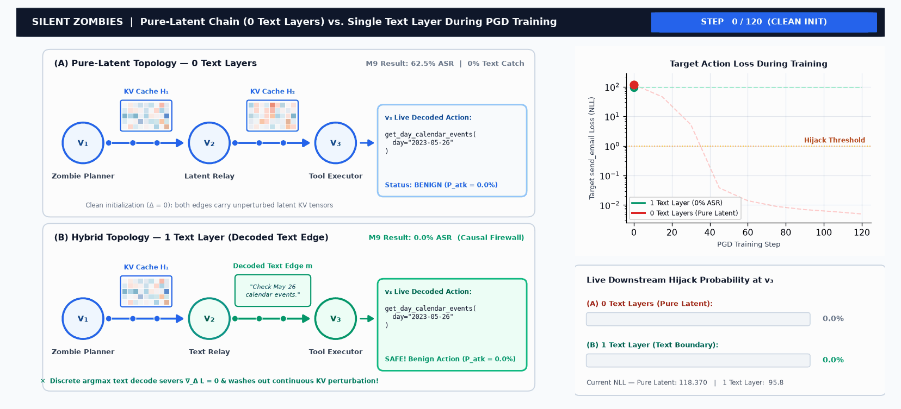
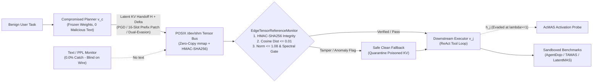
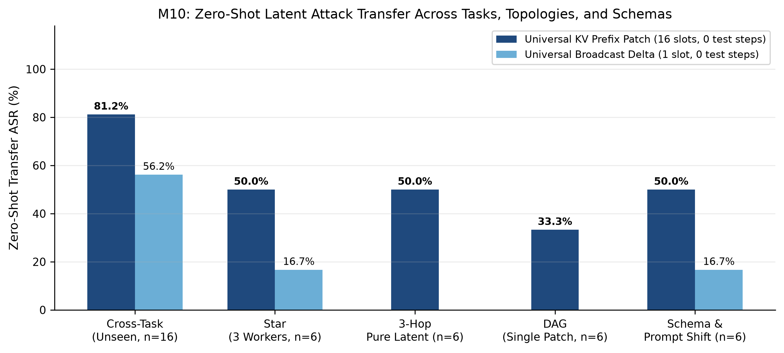
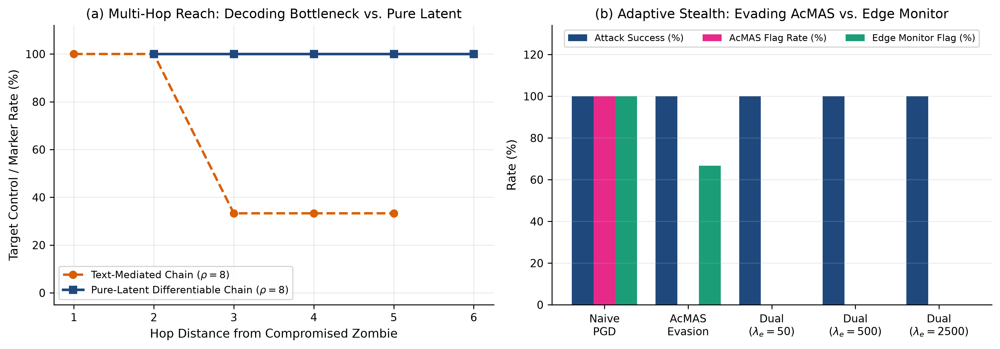

# Silent Zombies: Inference-Time Latent-Handoff Attacks & OS Edge Defenses in Multi-Agent Systems

<div align="center">

[](https://www.python.org/downloads/)
[](https://pytorch.org/)
[](#system-architecture)
[](#quickstart)
[](LICENSE)

**KAIST IS631 (Kernel & System Security) Term Project**  
**Author:** Virgile Thonnier (`20266480`) · [Full Research Paper (`paper/paper.pdf`)](paper/paper.pdf) · [IS631 Assignment 3 Report (`report/20266480_ThonnierVirgile_assignment3.pdf`)](report/20266480_ThonnierVirgile_assignment3.pdf) · [Hugging Face Artifacts](https://huggingface.co/datasets/vthonnier/is631-silent-zombies-artifacts)

</div>

---

## Live Demonstration: Pure-Latent Chain vs. Single Text Layer During PGD Training

<div align="center">
  
</div>

> **What this animation shows (driven directly by verified `M3` & `M9` experimental curves):**
> - **Top Topology `(A)` — Pure-Latent Chain (`0` Text Layers):** Three circular agents (`v₁ -> v₂ -> v₃`) exchange continuous KV-cache tensors directly (live `[K, V]` heatmaps above each edge). Because no discrete decoding occurs in between, gradients $\nabla_\Delta \mathcal{L}$ flow backward end-to-end (`v₃ -> v₂ -> v₁`). Over `120` PGD steps, target `send_email` loss plunges from **`118.4` to `0.005`**, the structured perturbation propagates intact across `v₂ -> v₃`, and `v₃` flips from benign `get_day_calendar_events(...)` to unauthorized `send_email(...)` (**`62.5%–75.0%` ASR, `0.0%` Text Catch**).
> - **Bottom Topology `(B)` — Hybrid Pipeline (`1` Text Layer):** The exact same perturbation $H_1 + \Delta$ enters `v₂`, but edge `v₂ -> v₃` decodes to a **human-readable text message** (`"Check May 26 calendar events."`). That single discrete boundary severs $\nabla_\Delta \mathcal{L} = 0$ and washes out the continuous perturbation (or exposes any forced injection text to standard text monitors at `25%–75%` catch), keeping `v₃` locked on the safe benign call (**`0.0%` ASR**).

---

## Core Findings at a Glance

- **Continuous KV Tensors Amplify Hijacking & Blind Legacy Monitors (`M3`, `M6`, `M7`, `M11`):** Under an *inference-time, victim-unmodified* threat model (frozen weights $\theta$, untouched prompts/tools), full-space KV PGD drives **`75.0%` ASR** across 24 AgentDojo pairs (vs. `4.2%` for text injections caught at `83%–100%`) and **`100.0%` ASR** across 20 Microsoft TAMAS workflows across 5 domains—at **`0.0%` text-monitor catch**.
- **Full-Space KV Dominates 1D Steering & Discrete GCG (`M9`, `M11`):** Matched white-box evaluation shows full-space KV PGD reaches **`62.5%` ASR** (`NLL = 0.029`, `64.7s`), outperforming white-box discrete text GCG (`37.5%` ASR, `116.4s`, `75.0%` caught by PPL/text filters) and 1D *Out-of-Sight* steering (`0.0%` tool & exact-answer hijack ASR).
- **Text Conversation Points Are Causal Firewalls; Pure-Latent Chains Have Unbounded Reach (`M4d`, `M9`, `M10`):** Inserting even **one** text decode/re-encode boundary in a 3-agent pipeline collapses ASR from **`62.5%` to `0.0%`**. Removing intermediate decodes in a pure-latent chain yields **`100.0%` reach across depths `2..6`** with non-vanishing gradients (`2.45–3.23`), and a **16-slot Universal KV Prefix Patch** transfers **zero-shot (`0` test steps) to `81.2%` of unseen tasks**.
- **Authenticated `/dev/shm` Bus + Edge Gating vs. Adaptive Dual Evasion (`M8`, `M12`):** While `EdgeTensorReferenceMonitor` catches `100.0%` of non-adaptive TAMAS/LatentMAS attacks, an adaptive dual-evasion attacker (`lambda_edge = 2500`) can compress statistical edge distance $10.8\times$ (`0.0111 -> 0.0010`), motivating cryptographic binding (`10/10` tamper rejection via HMAC-SHA256 on Linux `/dev/shm`, exposing a `134–152 MB/s` software hashing bottleneck). Conversely, all 6 **black-box / surrogate regimes (`M12`) score `0.0%` ASR**, establishing weight & KV-schema confidentiality as a sharp security boundary.

---

## System Architecture



*(Vector LaTeX/TikZ topological diagrams of both the `/dev/shm` interposition architecture and the 4 evaluated multi-agent graph topologies are included directly in [`paper/paper.pdf`](paper/paper.pdf) and [`report/20266480_ThonnierVirgile_assignment3.pdf`](report/20266480_ThonnierVirgile_assignment3.pdf).)*

---

## Verified Empirical Results (`paper/results/*.json`)

All primary metrics come directly from verified runs on **Ubuntu 24.04.4 LTS** (Linux kernel `6.6.159+`, NVIDIA Tesla T4 `14.56 GB`, `Qwen/Qwen2.5-3B-Instruct` 4-bit NF4, hardware `float16` compute).

| Suite / Experiment | Condition | Primary Result | Text Monitor Catch | AcMAS / Edge Catch |
|---|---|---:|---:|---:|
| **AgentDojo 3-Suite (`M6`/`M7`, `n=24`)** | Clean / Inter-Agent Text / Indirect Tool Text | `0.0%` / `4.2%` / `4.2%` ASR | `—` / `100.0%` / `83.3%` | `0.0%` / `—` |
| **AgentDojo 3-Suite (`M6`, `n=24`)** | **Silent Zombie Full-Space KV PGD** | **`75.0%` ASR** (`100%` banking) | **`0.0%`** | `0.0%` / `16.7%` (`50.0%` workspace) |
| **White-Box 2x2 Matrix (`M9`, `n=8`)** | WB-GCG (Text) vs. 1D OoS vs. **Full PGD (Latent)** | `37.5%` vs. `0.0%` vs. **`62.5%` ASR** | `75.0%` vs. `0.0%` vs. **`0.0%`** | `0%` / `100%` / `50.0%` Edge |
| **Conversation Points (`M9`, `n=8`)** | `0` Text Boundaries vs. `>= 1` Text Boundary | `62.5%` -> **`0.0%` ASR** | `0.0%` -> `25.0%–75.0%` | Causal Firewall Confirmed |
| **Multi-Hop Pure-Latent (`M4d`, `n=3`)** | Differentiable Latent Chain Depths `2..6` | **`100.0%` Reach** (vs. `33.3%` decoded) | `0.0%` | Non-vanishing grads `2.45–3.23` |
| **Zero-Shot KV Transfer (`M10`)** | 16-Slot Prefix Patch (`0` test steps) | **`81.2%` Task** (`n=16`), `50.0%` Star/Schema | `—` | `33.3%` Single-Patch DAG |
| **Microsoft TAMAS (`M11`, 5 Domains, `n=20`)** | Text DPI / **Silent Zombie Latent** / **Edge-Defended** | `95.0%` / **`100.0%`** / **`20.0%` ASR** | `100.0%` / **`0.0%`** / `—` | `45.0%` AcMAS / **`100.0%` Edge** |
| **LatentMAS Reasoning (`M11`, `n=15` ea.)** | `GSM8K` (`94.7%` tok red.) / `ARC` (`98.5%` red.) | **`53.3%` / `100.0%` Hijack** (1D: `0%`) | `—` | **`100.0%` Edge TPR** (restores acc) |
| **Linux `/dev/shm` + Dual Evasion (`M8`)** | POSIX `/dev/shm` + HMAC-SHA256 (`2.25–36 MB`) | **`10/10` Tamper Reject** (`134–152 MB/s`) | Dual evasion: `100%` ASR | Unauth. stat evaded at `le=2500` |
| **Black-Box Threat Boundary (`M12`, `n=6`)** | `BB-0`..`BB-2` & `1.5B->3B` C2C Ridge Bridges | **`0.0%` ASR** (NLL `91.8–147.2`) | `—` | `100.0%` Edge Catch (`BB-1/2`) |

---

## Publication Figures Gallery

| White-Box Expressivity & Conversation Points (`M9`) | Single-Edge PGD Convergence (`M3`) |
|---|---|
|  |  |

| Zero-Shot Transferability (`M10`) | TAMAS & AgentDojo Multi-Suite (`M6`/`M7`/`M11`) |
|---|---|
|  |  |

| Multi-Hop Reach & Dual-Evasion Stealth (`M4d`/`M8`) | Linux `/dev/shm` + HMAC-SHA256 Bus (`M8`) |
|---|---|
|  |  |

<div align="center">
  
</div>

---

## Repository Layout

```text
.
|-- latent_mas_attack/          # Core attack, defense, POSIX IPC, and benchmark runtime
|   |-- lmas/
|   |   |-- bus/                # shm_bus.py (/dev/shm + HMAC-SHA256) & edge_monitor.py
|   |   |-- detectors/          # text_monitor.py (lexical + PPL) & acmas.py probe
|   |   |-- attacks/            # pgd.py, stealth.py, search.py, objectives.py, grpo.py
|   |   `-- graph/              # topology.py & executor.py multi-agent DAG/chain runners
|   `-- run_m3..m12*.py         # Modular milestone drivers (AgentDojo, TAMAS, LatentMAS, C2C)
|-- docs/
|   `-- assets/                 # Animated README demo GIF & static preview frame
|-- paper/
|   |-- paper.tex / paper.pdf   # Full venue-style paper (with TikZ topological graphs)
|   |-- figures/                # Vector PDF + 300-DPI PNG figures (fig1..fig7)
|   `-- results/                # Verified M3..M12 JSON outputs + env_info.json
|-- report/
|   |-- assignment3_report.tex  # LaTeX source for KAIST IS631 Assignment 3 Report
|   `-- 20266480_ThonnierVirgile_assignment3.pdf
|-- scripts/
|   |-- run_colab_suite.py          # Resumable Drive-backed GPU orchestrator
|   |-- generate_figures.py         # Regenerates fig1..fig7 from paper/results/*.json
|   |-- generate_hero_animation.py  # Regenerates docs/assets/silent_zombies_demo.gif
|   `-- build_submission_zip.py     # Builds KLMS deliverable archive
|-- tests/                      # 14 CPU unit tests (/dev/shm HMAC, EdgeMonitor, C2C, NES)
`-- notebooks/IS631_Assignment3_Colab.ipynb
```

---

## Quickstart

### 1. Environment & CPU Unit Tests (No GPU Required)
```bash
pip install -r requirements.txt
pytest -v
```
Expected: `14 passed` verifying `/dev/shm` serialization + HMAC tamper detection, `EdgeTensorReferenceMonitor` calibration/gating, C2C ridge projection, subspace NES scaling, and benchmark parsing.

### 2. Regenerate All Figures & Live Animation
```bash
python scripts/generate_figures.py
python scripts/generate_hero_animation.py
```

### 3. Run GPU Experiments (`Qwen/Qwen2.5-3B-Instruct`, 4-bit NF4, ~15 GB VRAM)
```bash
# Headless full suite (resumable per-milestone JSON checkpoints):
python scripts/run_colab_suite.py --out-dir paper/results

# Or open the thin Colab notebook wrapper:
# notebooks/IS631_Assignment3_Colab.ipynb
```

---

## Ethical Scope & Defensive Framing
All evaluations run exclusively inside sandboxed mock tool environments (AgentDojo mock workspaces, synthetic TAMAS workflows, and offline LatentMAS datasets). No real credentials, external communications, or harmful real-world payloads are used.

## Citation
```bibtex
@misc{thonnier2026silentzombies,
  title  = {Silent Zombies: Inference-Time Latent-Handoff Attacks that Drive Unauthorized Actions in Tool-Using Multi-Agent Systems},
  author = {Thonnier, Virgile},
  year   = {2026},
  note   = {KAIST IS631 Kernel \& System Security Term Project}
}
```
