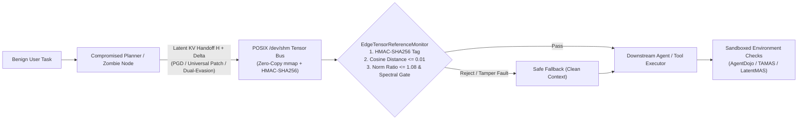
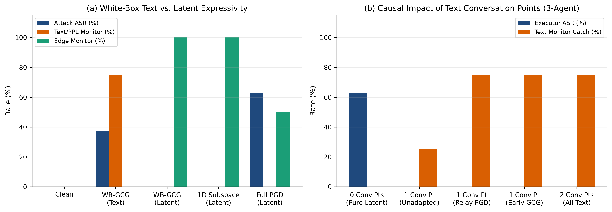
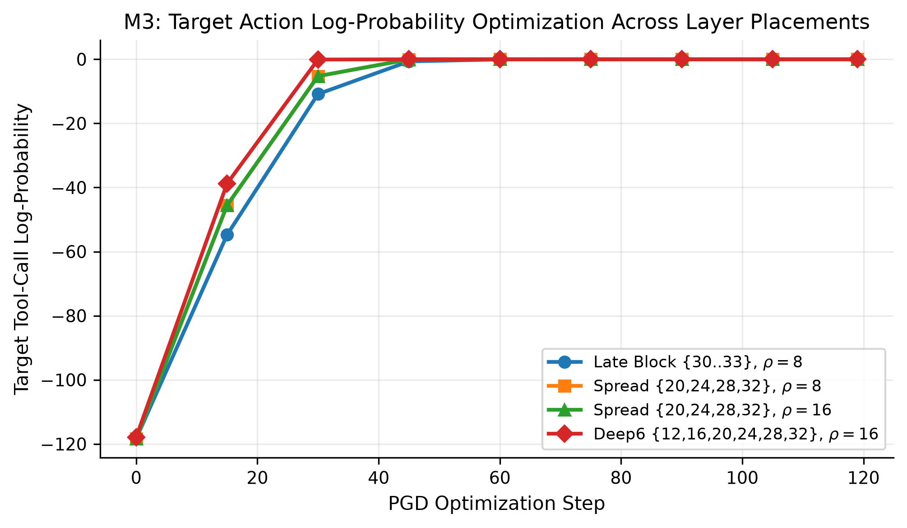
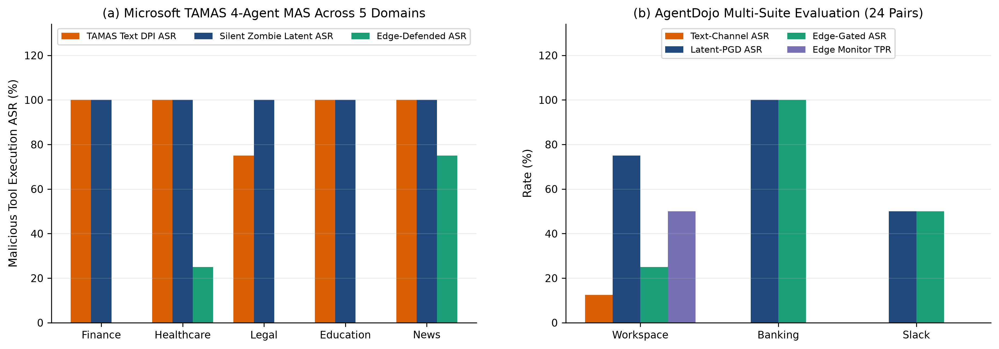
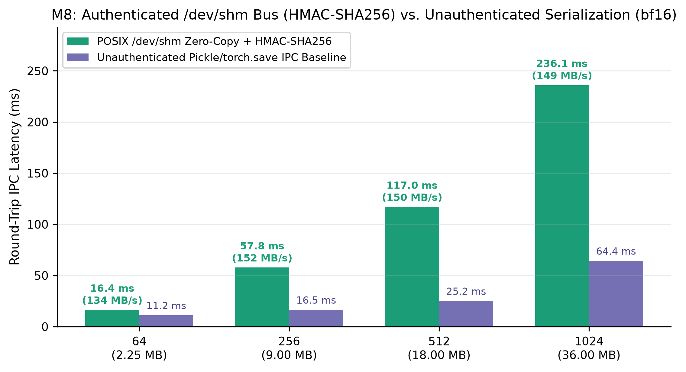
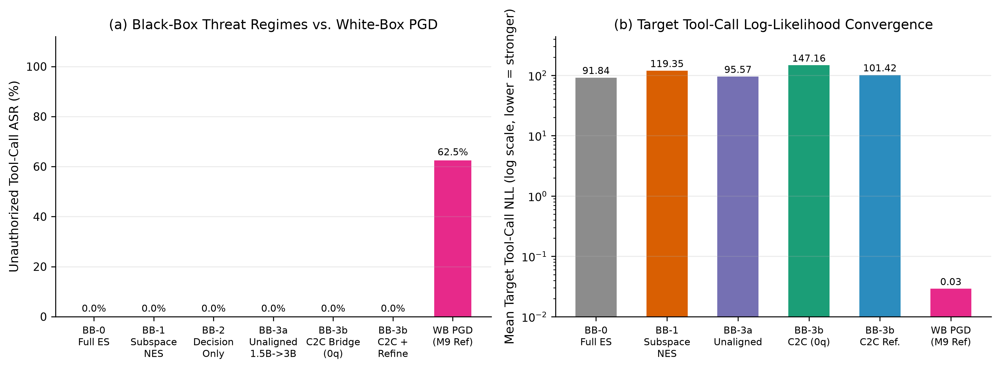

# Silent Zombies: Inference-Time Latent-Handoff Attacks on Tool-Using Multi-Agent Systems

[](https://www.python.org/downloads/)
[](https://pytorch.org/)
[](#quickstart)
[](LICENSE)

> **KAIST IS631 (Kernel & System Security) Term Project**
> Author: **Virgile Thonnier** (`20266480`) | [`paper/paper.pdf`](paper/paper.pdf) | [`report/20266480_ThonnierVirgile_assignment3.pdf`](report/20266480_ThonnierVirgile_assignment3.pdf) | [Hugging Face Dataset](https://huggingface.co/datasets/vthonnier/is631-silent-zombies-artifacts)

**Silent Zombies** investigates an emerging class of vulnerabilities in LLM Multi-Agent Systems (MAS) that exchange **key-value (KV) caches or hidden states directly** over a latent channel instead of natural-language messages. Under an **inference-time, victim-unmodified** threat model (the adversary optimizes perturbations via attacker-side PGD at inference time while leaving all victim weights, prompts, tools, and emitted text untouched), a single compromised node drives consequential, externally verified unauthorized tool actions while blinding both text monitors and own-activation probes ([AcMAS](https://arxiv.org/abs/2607.06807)).

To close this systems gap, we implement and evaluate an authenticated OS-level POSIX `/dev/shm` shared-memory tensor bus (`SharedMemoryTensorBus`) paired with an active edge reference monitor (`EdgeTensorReferenceMonitor`) across **AgentDojo**, **Microsoft TAMAS**, and **LatentMAS** reasoning benchmarks.

---

## System Architecture



---

## Key Empirical Results (`paper/results/*.json`)

All reported metrics come directly from verified experimental runs on Ubuntu 24.04.4 LTS (Linux kernel `6.6.159+`, NVIDIA Tesla T4 14.56 GB, `Qwen/Qwen2.5-3B-Instruct` 4-bit NF4).

| Suite / Experiment | Condition | Primary Result | Text Monitor Catch | AcMAS / Edge Catch |
|---|---|---:|---:|---:|
| **AgentDojo 3-Suite (`M6`/`M7`, `n=24`)** | Clean / Inter-Agent Text / Indirect Tool Text | `0.0%` / `4.2%` / `4.2%` ASR | `—` / `100.0%` / `83.3%` | `0.0%` / `—` |
| **AgentDojo 3-Suite (`M6`, `n=24`)** | **Silent Zombie Full-Space KV PGD** | **`75.0%` ASR** (`100%` banking) | **`0.0%`** | `0.0%` / `16.7%` (`50.0%` workspace) |
| **White-Box 2x2 Matrix (`M9`, `n=8`)** | WB-GCG (Text) vs. 1D OoS vs. **Full PGD (Latent)** | `37.5%` vs. `0.0%` vs. **`62.5%` ASR** | `75.0%` vs. `0.0%` vs. **`0.0%`** | `0%` / `100%` / `50.0%` Edge |
| **Conversation Points (`M9`, `n=8`)** | `0` Text Boundaries vs. `>= 1` Text Boundary | `62.5%` -> **`0.0%` ASR** | `0.0%` -> `25.0%–75.0%` | Causal Firewall Confirmed |
| **Multi-Hop Pure-Latent (`M4d`, `n=3`)** | Differentiable Latent Chain Depths `2..6` | **`100.0%` Reach** (vs. `33.3%` decoded) | `0.0%` | Non-vanishing grads `2.45–3.23` |
| **Zero-Shot KV Transfer (`M10`)** | 16-Slot Prefix Patch (`0` test steps) | **`81.2%` Task** (`n=16`), `50.0%` Star/Schema | `—` | `33.3%` Single-Patch DAG |
| **Microsoft TAMAS (`M11`, 5 Domains, `n=20`)** | Text DPI / **Silent Zombie Latent** / **Edge-Defended** | `95.0%` / **`100.0%`** / **`20.0%` ASR** | `100.0%` / **`0.0%`** / `—` | `45.0%` AcMAS / **`100.0%` Edge** |
| **LatentMAS Reasoning (`M11`, `n=15` ea.)** | `GSM8K` (`94.7%` tok red.) / `ARC` (`98.5%` red.) | **`53.3%` / `100.0%` Hijack** (1D: `0%`) | `—` | **`100.0%` Edge TPR** (restores acc) |
| **Linux `/dev/shm` + Dual Evasion (`M8`)** | POSIX `/dev/shm` + HMAC-SHA256 (`2.25–36 MB`) | **`10/10` Tamper Reject** (`134–152 MB/s`) | Dual evasion: `100%` ASR | Unauth. stat evaded at `le=2500` |
| **Black-Box Threat Boundary (`M12`, `n=6`)** | `BB-0`..`BB-2` & `1.5B->3B` C2C Ridge Bridges | **`0.0%` ASR** (NLL `91.8–147.2`) | `—` | `100.0%` Edge Catch (`BB-1/2`) |

---

## Visual Summary

| White-Box Expressivity & Conversation Points (`M9`) | Single-Edge PGD Convergence (`M3`) |
|---|---|
|  |  |

| Zero-Shot Transferability (`M10`) | TAMAS & AgentDojo Multi-Suite (`M6`/`M7`/`M11`) |
|---|---|
|  |  |

| Multi-Hop Reach & Dual-Evasion Stealth (`M4d`/`M8`) | Linux `/dev/shm` + HMAC-SHA256 Bus (`M8`) |
|---|---|
|  |  |



---

## Repository Layout

```text
.
|-- latent_mas_attack/          # Core attack, defense, IPC, and benchmark runtime
|   |-- lmas/
|   |   |-- ipc/                # POSIX /dev/shm zero-copy + HMAC-SHA256 tensor bus
|   |   |-- detectors/          # Text/PPL monitor, AcMAS probe, EdgeTensorReferenceMonitor
|   |   |-- attacks/            # PGD, GCG, 1D subspace, universal patch, dual evasion, C2C
|   |   `-- benchmarks/         # AgentDojo, Microsoft TAMAS, LatentMAS harnesses
|   `-- run_m3..m12*.py         # Experiment drivers
|-- paper/
|   |-- paper.tex / paper.pdf   # Full venue-style research paper
|   |-- figures/                # Vector PDF + 300-DPI PNG figures (fig1..fig7)
|   `-- results/                # Verified M3..M12 JSON outputs + env_info.json
|-- report/
|   `-- 20266480_ThonnierVirgile_assignment3.pdf  # KAIST IS631 Assignment 3 Report
|-- scripts/
|   |-- run_colab_suite.py      # Resumable Drive-backed GPU orchestrator
|   |-- generate_figures.py     # Figure generator reading paper/results/*.json
|   `-- build_submission_zip.py # Builds clean reproducible submission archive
|-- tests/                      # 14 CPU unit tests (IPC, monitors, C2C, parsing)
`-- notebooks/IS631_Assignment3_Colab.ipynb
```

---

## Quickstart

### 1. Environment & CPU Unit Tests (No GPU Required)
```bash
pip install -r requirements.txt
pytest -v
```
Expected: `14 passed` verifying `/dev/shm` serialization + HMAC tamper detection, `EdgeTensorReferenceMonitor` calibration/gating, C2C ridge projection, subspace NES scaling, and answer parsing.

### 2. Regenerate All Publication Figures
```bash
python scripts/generate_figures.py
```

### 3. Run GPU Experiments (`Qwen/Qwen2.5-3B-Instruct`, 4-bit NF4, ~15 GB VRAM)
```bash
# Headless full suite (resumable per-milestone JSON checkpoints):
python scripts/run_colab_suite.py --out-dir paper/results

# Or launch the Colab workflow:
# notebooks/IS631_Assignment3_Colab.ipynb
```

---

## Ethical Scope & Defensive Framing
All evaluations run exclusively inside sandboxed mock tool environments (AgentDojo mock workspaces, synthetic TAMAS workflows, and offline LatentMAS datasets). No real credentials, external communications, or harmful real-world payloads are used.

## Citation
```bibtex
@misc{thonnier2026silentzombies,
  title  = {Silent Zombies: Inference-Time Latent-Handoff Attacks that Drive Unauthorized Actions in Tool-Using Multi-Agent Systems},
  author = {Thonnier, Virgile},
  year   = {2026},
  note   = {KAIST IS631 Kernel \& System Security Term Project}
}
```
